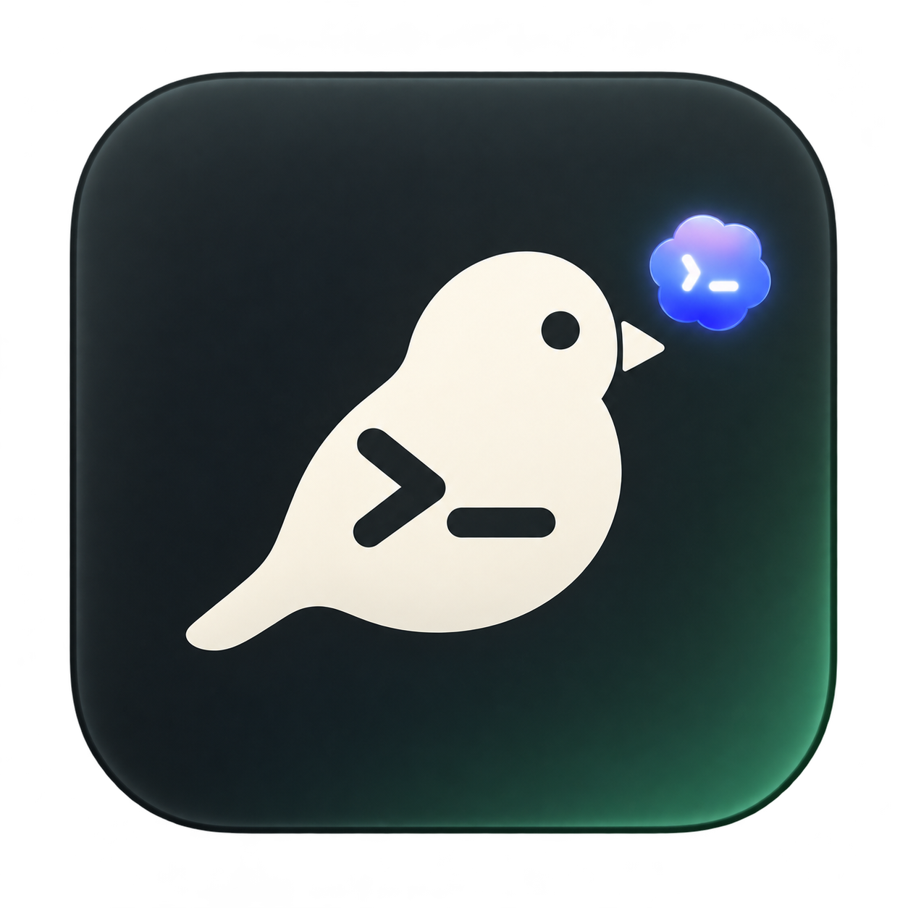

<p align="center"></p>

# Codex Finch

A lightweight macOS menu bar companion for Codex usage, sessions, and notifications.

[简体中文](README.zh-CN.md) · [Download](https://github.com/zhangliyuangit/codex-finch/releases) · [How it works](docs/architecture.md)

Finch keeps useful Codex numbers close by: today's recorded local tokens, your latest account quota snapshot, and project-grouped sessions. Click a session to open its conversation in Codex.

## 20-second demo

<p></p>

The animation uses native Finch captures and fictional data. The final Codex handoff is illustrated; no real conversations are shown.

<p> </p>

<p></p>

Screenshots use synthetic projects and usage records. They are native view renders; the surrounding menu strip is a preview scene.

## Features

- Configurable menu bar: today's tokens, remaining quota, active sessions, or icon only.
- Compact sessions grouped by project, with running/waiting filters and conversation links.
- Today’s tokens broken down by project and model, with 7/30-day observed local history.
- System-backed launch-at-login toggle and configurable 24/50/100 recent main conversations.
- Explicit GitHub release checks and sanitized diagnostics without conversation titles or paths.
- Running, waiting, completed, interrupted, and failed states when local records expose them.
- Optional macOS notifications for completion, attention, and low quota. Sound is separately configurable; notifications start disabled.
- Native AppKit + SwiftUI, light and dark appearances, no Dock icon.
- File-event-driven collection, incremental reads, and a persistent daily index. No network requests, model calls, or periodic polling by Finch.

## Install

Requirements: macOS 14 or later and a locally used Codex desktop installation with session metadata and rollout logs. The downloadable build targets Apple Silicon. Intel source builds have not been verified.

1. Download the ZIP from [Releases](https://github.com/zhangliyuangit/codex-finch/releases).
2. Unzip it and drag **Codex Finch.app** to Applications.
3. Open Finch. If macOS blocks this ad-hoc-signed, unnotarized build, use Finder's Open action or the approval offered in Privacy & Security, after reviewing the source and release checksum.

Launch at login starts off. Enable it in Preferences; if macOS requires approval, use Open Login Items Settings. An existing owned Finch LaunchAgent is retained until modern registration succeeds. Turning the toggle off does not quit the current app.

Enabling notifications requests macOS permission. Test Notification checks delivery; System Notification Settings opens the native settings page.

## What the numbers mean

| Metric | Scope |
| --- | --- |
| Today's tokens | Recorded usage on this Mac, from local midnight in the system timezone; includes archived sessions and subagents independently of the visible list. |
| Session tokens | The latest recorded cumulative total for that conversation. |
| Remaining quota | An account-wide snapshot from Codex logs, with its observation and reset times. It updates when Codex writes a new record. |
| Active sessions | Sessions with recent running evidence among the 24/50/100 monitored main conversations. |

Cached input is already included in input; reasoning output is already included in output. They are not added twice. A `≥` prefix means coverage is incomplete or relies on legacy records. Local token totals are not an account-wide bill, and Finch does not convert subscription quota into a fabricated per-session dollar charge.

History retains up to 30 days of indexed records. First launch reads today’s relevant logs only; history accumulates with use, older days are explicitly lower bounds (≥), and absent days do not mean zero spend. Project ownership comes from current local metadata; unknown projects/models remain explicit. Daily project/model rows use deduplicated response amounts, never historical session totals.

Local metadata and log formats are internal Codex implementation details and may change. Waiting detection covers explicit blocking-input/approval records; some approval paths are not present in logs. Running evidence older than ten minutes becomes unknown rather than being declared completed.

## Build and test

Install Xcode Command Line Tools. No third-party runtime packages are needed.

```sh
git clone https://github.com/zhangliyuangit/codex-finch.git
cd codex-finch
zsh build.sh                 # build/Codex Finch.app, native architecture
zsh test.sh                  # parser, collector, grouping, activity, daily index
```

The icon build uses macOS `sips` and `iconutil`. Builds are ad-hoc signed. See [architecture and diagnostics](docs/architecture.md) for test-fixture rendering and collector details.

## Privacy and performance

Finch reads local metadata and selected rollout records. An explicit Check for Updates action calls the public GitHub Releases API without sending conversation data. No automatic update downloads or execution occur. Normal collection writes only preferences and its own daily cache; it does not modify Codex's database or rollouts. The cache stores usage IDs, counters, and read offsets, not conversation bodies or credentials. Titles appear in the panel and optional notifications; Finch sends nothing to a server.

The collector watches files, coalesces changes, and reads only new bytes after its initial load. First use and a new calendar day can require streaming today's relevant logs. The panel is created when opened and released when closed. See [measured limits](docs/architecture.md#validation) for the distinction between local measurements and guarantees.

## Contributing and license

Bug reports and focused pull requests are welcome. Include macOS/Codex versions and redacted record shapes when reporting format changes; do not upload actual conversations or authentication files. Run `zsh test.sh` and `zsh build.sh` before submitting.

Code is [MIT licensed](LICENSE). Codex Finch is an independent project and is not affiliated with OpenAI. Codex/OpenAI names and marks belong to their respective owners; the code license does not grant rights to those marks. See [artwork provenance](docs/artwork.md).
