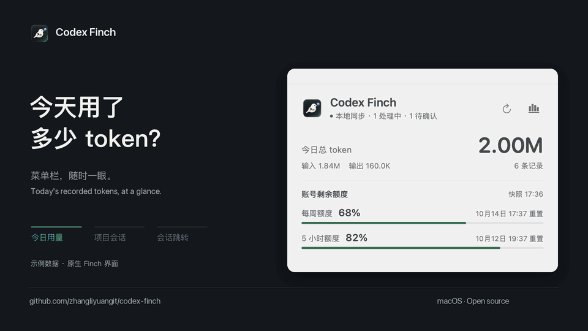
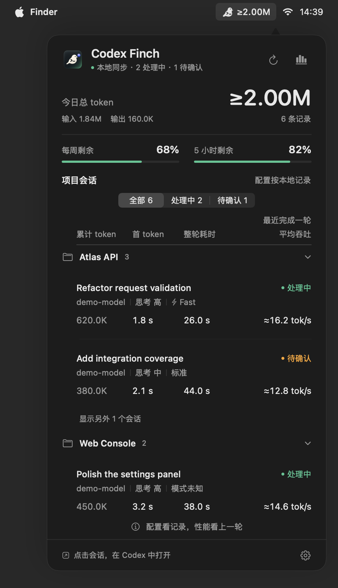
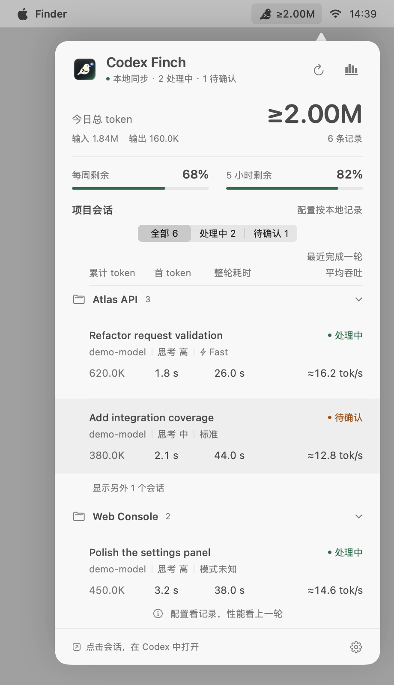
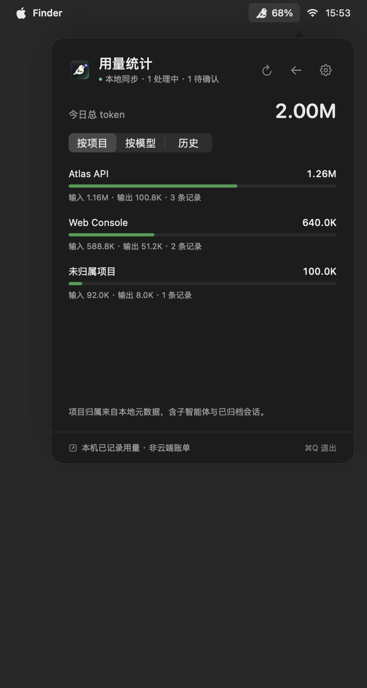

# Codex Finch · 小雀

菜单栏里的 Codex 用量与会话助手。

[English](README.md) · [下载](https://github.com/zhangliyuangit/codex-finch/releases) · [技术说明](docs/architecture.md)

## 20 秒演示

<p></p>

动画展示 0.6.1，使用 Finch 原生画面和虚构数据；最后的 Codex 跳转为示意，不展示真实会话内容。下方面板截图对应当前源码。

<p> </p>

<p></p>

截图使用虚构项目和用量；面板为原生视图渲染，外层菜单栏是预览场景。

## 能看什么

- 菜单栏可设置：今日 token、剩余额度、活跃会话数、仅图标。
- 会话按项目分组，可折叠，点击会话跳转到 Codex；保留处理中或待确认筛选，无搜索框。
- 每条会话直接显示最近完成一轮的首 token 延迟、整轮耗时与估算平均吞吐；多任务并行时原位更新，面板打开期间不重新排序。
- 会话旁展示已记录的模型、思考程度和 Fast/标准模式；缺失时明确显示未知。指标共用列标题，额度并排显示，减少重复文字。
- 今日用量按项目、模型拆分；查看最近 7/30 天已索引的本机历史。
- 设置中开启登录后自动启动，可选择监测最近 24/50/100 条主会话。
- 手动检查 GitHub 新版、复制不含标题和路径的诊断。
- 从本地记录识别处理中、待确认、结束、中断和失败。
- 可选系统通知：任务结束、需要确认、低额度；提示音单独设置，默认关闭通知。
- 原生 AppKit + SwiftUI，支持深浅外观，不占 Dock。

## 安装

需要 macOS 14+，以及使用过本地会话的 Codex 桌面客户端。下载包为 Apple Silicon 构建；Intel 可尝试源码构建，但尚未验证。

到 [Releases](https://github.com/zhangliyuangit/codex-finch/releases) 下载 ZIP，解压后将 **Codex Finch.app** 拖入“应用程序”。当前构建为临时签名，未公证；如被 macOS 拦截，在核对源码和校验值后，通过访达的“打开”或“隐私与安全性”中的批准入口打开。

开机启动默认关闭，可在偏好设置中开启“登录后自动启动”。macOS 如要求批准，使用“打开登录项设置”完成允许。本机已有的 Finch 启动项会保留到系统登录项注册成功，再迁移；关闭开关不会结束当前应用。

开启通知时请求 macOS 授权，可以用“测试通知”检查本机投递，“系统通知设置”用于调整横幅和专注模式相关配置。

## 统计口径

| 指标 | 含义 |
| --- | --- |
| 今日 token | 系统时区 0 点起，本机已记录用量；包含已归档会话和子智能体，不受列表 24 条限制。 |
| 会话累计 | 当前会话最后一次记录的累计 token。 |
| 单轮指标 | 最近完成一轮中日志记录的首 token 延迟与耗时；均速约等于该轮输出 token / 整轮耗时，包含推理、工具执行与等待，不是纯生成速度。 |
| 剩余额度 | 账号共享额度快照，并展示记录时间和重置时间；Codex 写入新记录后才更新。 |
| 活跃会话 | 监听的最近 24/50/100 个主会话中，有近期运行证据的会话数量。 |
| 已记录配置 | 来自本地会话数据的模型、思考程度与服务模式。明确记录 `priority`/`fast` 才显示 Fast，`default` 显示标准；缺失不代表关闭，也不保证实际请求使用了相同服务等级。 |

缓存输入已包含在输入中，推理输出已包含在输出中，不重复相加。`≥` 表示统计不完整或依赖旧格式。今日总量仅覆盖本机记录，不能当作账号云端账单；不会将订阅额度换算成虚构的单会话费用。

历史保留最近 30 天已索引的记录，首次只读取今日更新过的日志，随后随使用积累；空缺日期不代表零消耗，旧日期的历史与旧格式统计以 `≥` 标注，表示已记录下限。项目按当前本地归属分配，未知项目或模型单独显示。项目、模型的今日拆分之和与去重总量一致，不使用会话历史累计作为当天消费。

日志和数据库是 Codex 内部实现，格式变化时可能暂不兼容。待确认只覆盖日志中明确的阻塞请求/审批记录；部分审批流程没有对应记录。运行证据超过 10 分钟会显示待更新，不自动认定任务完成。

字段缺失显示 `—`。处理中或待确认时保留并标明“上一轮”的指标；新会话提示重开查看，已有行继续原位更新。单轮指标仅针对本地主轮，不合并独立子智能体会话。

配置取最近观察到的本地记录，不套用全局默认值。有界尾读可能没有读到较早的配置，届时模式保持未知；日志跳读、显式重置或元数据冲突时会撤销旧模式证据。模型和思考程度可使用会话元数据回退，也兼容没有思考字段的旧数据库。悬停会话查看来源与时间，悬停额度查看快照与重置时间，辅助功能标签保留这些信息。

## 构建与验证

安装 Xcode Command Line Tools，无第三方运行时依赖。

```sh
git clone https://github.com/zhangliyuangit/codex-finch.git
cd codex-finch
zsh build.sh
zsh test.sh
```

正常采集不发网络请求、不调用模型、不定时轮询。只有手动点击“检查更新”才访问公开 GitHub Releases 接口，不携带会话数据、不自动下载或执行更新。通过文件事件触发增量读取，首次和跨日时需要流式回填当天相关日志。仅保存自己的偏好和用量索引，不修改 Codex 的数据库或日志。索引不保存原始聊天内容、命令输出或凭证；会话标题用于界面及可选通知，不向服务端上传。

代码使用 [MIT](LICENSE) 许可。本项目独立开发，与 OpenAI 无关联；Codex/OpenAI 标志归各自权利人所有，代码许可不授予其标志权利。详见 [图标说明](docs/artwork.md)。
